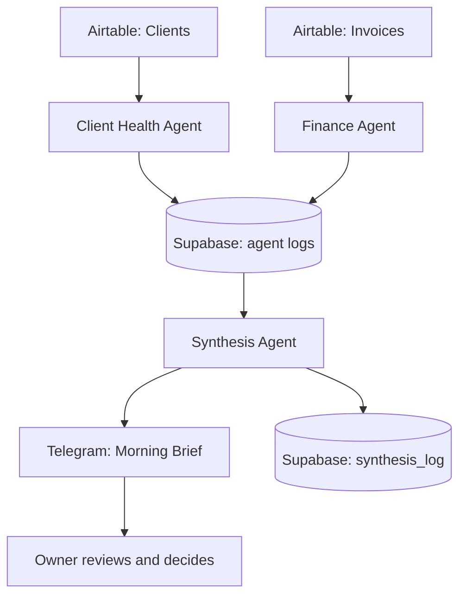

# Ruby AI CEO: A Multi-Agent Business Monitor Built in n8n

> One message every morning that tells a business owner which clients need attention first, and why.

Built by **Queen Ikwuji**, founder of [QueenEagleAI](https://queeneagleai-plum-iota.vercel.app)

**Stack:** n8n · Google Gemini · Airtable · Supabase · Telegram

---

## The problem, in plain English

Most agency owners find out a client is unhappy too late.

The warning signs are usually there. The client goes quiet. An invoice sits unpaid. A deliverable slips. But each sign lives in a different tool, so nobody connects them until the client has already decided to leave.

## What this project does

This is an **AI CEO** for a UK marketing agency (Ruby Marketing Agency). It is not a robot boss and it does not make decisions. Think of it as a chief of staff that never sleeps: it checks every client every weekday morning, connects the dots across departments, and sends the owner a short, ranked list of what needs attention today.

It is made of three AI agents that work as a team:

| Agent | Runs at | Reads | Looks for |
|---|---|---|---|
| **Client Health Agent** | 7:00am, Mon to Fri | Airtable `Clients` | Silent clients, stalled deliverables, worrying notes |
| **Finance Agent** | 7:05am, Mon to Fri | Airtable `Invoices` | Overdue, disputed and part-paid invoices |
| **Synthesis Agent** | 7:15am, Mon to Fri | Both agents' logs in Supabase | Problems that **compound** across departments |

Each agent saves its findings to a database, so the system builds a memory of every client over time instead of starting from zero each day.

## Sample output

This is a real brief produced by the system (all client names and figures are fictional demo data):

```text
Ruby: Morning Brief

Today's review highlights three clients requiring immediate attention
due to compounding issues across departments or critical stalls...

Top priorities today:

1. 🔴 Finch & Hale Interiors: Critical disengagement and highly overdue payment
A complete lack of contact and a delayed deliverable, combined with a
highly overdue invoice and unresponsiveness to reminders...
→ Proactive outreach is critical to understand the reasons for the silence
and address both the delayed deliverable and the urgent payment issue.

2. 🔴 Bright Leaf Dental: Significant disengagement and overdue payment
Client disengagement and missed deliverables from Client Health are
compounded by a significantly overdue invoice from Finance...
→ Urgent outreach is needed to re-establish contact and follow up on payment.

Also watching: Thistledown Café Group: invoice dispute and minor
communication delay; Northfield Builders: minor invoice delay
```

The key insight is in priority 2. Neither agent alone would call Bright Leaf an emergency. Together, a quiet client **and** a late invoice is a churn risk worth a phone call this week.

## Architecture


The Synthesis Agent workflow in n8n


The morning brief as it arrives in Telegram


Every agent follows the same simple pattern: **fetch data → build a focused prompt → ask Gemini → parse the answer → log it → send it.** Because the pattern repeats, adding a new agent (Operations, Performance) means adding another input, not rebuilding anything.

## Design decisions worth explaining

**1. The AI advises. The human decides.**
The system never emails a client, chases an invoice or changes anything on its own. The prompts forbid recommending legal action, ending contracts, discounts or write-offs. Those are the owner's calls.

**2. Code does the maths. AI does the judgment.**
AI models are unreliable at date arithmetic. So "17 days overdue" is calculated in code and handed to Gemini as a finished fact. Gemini only decides what it means and what to do about it.

**3. Explicit risk scales, not vibes.**
Without clear rules, the AI rated almost everything "high". Each agent now has a written low, medium and high rubric, and ranking puts **severity first**: one serious problem is never outranked by several mild ones.

**4. Same data in, same answer out.**
Gemini runs at `temperature: 0` with JSON output mode, so identical data gives identical scores run after run. In an early test the same invoice was rated "low" once and "medium" three times.

**5. Separate workflows, shared memory.**
Each agent is its own workflow, so one failing does not take the others down. Supabase is the shared memory between them.

**6. It notices when an agent goes silent.**
If the Client Health or Finance agent did not log anything today, the morning brief ends with a warning. A broken workflow can never look like "all clear".

**7. Describe, do not speculate.**
The Synthesis prompt tells the AI to report what the data shows, not guess at a client's motives or finances.

## Setup

### Prerequisites
- An [n8n](https://n8n.io) instance (cloud or self-hosted)
- Airtable account and a personal access token
- Google Gemini API key
- Supabase project
- Telegram bot (create one with [@BotFather](https://t.me/BotFather)) and your chat ID

### 1. Airtable

**`Clients` table**

| Field | Type |
|---|---|
| `Name` | Single line text |
| `LastContactDate` | Date |
| `ClientStatus` | Single select: Active, Onboarding, Paused, Churned, Prospect |
| `DeliverableStatus` | Single select: On Track, Delayed, Blocked, Delivered |
| `EngagementNotes` | Long text |

**`Invoices` table**

| Field | Type |
|---|---|
| `ClientName` | Single line text |
| `InvoiceNumber` | Single line text |
| `AmountGBP` | Number |
| `InvoiceDate` | Date |
| `DueDate` | Date |
| `PaymentStatus` | Single select: Sent, Paid, Partially Paid, Disputed |
| `Notes` | Long text |

> Field names must match exactly (case-sensitive). One mismatched word makes the agent see "Unknown" for every client.

There is deliberately no "Overdue" status. Overdue is calculated from the due date, so nobody has to remember to update it.

### 2. Supabase

Run this in the SQL Editor:

```sql
create table client_health_log (
  id uuid primary key default gen_random_uuid(),
  created_at timestamptz default now(),
  client_name text,
  risk_level text,
  summary text,
  raw_response text
);

create table finance_health_log (
  id uuid primary key default gen_random_uuid(),
  created_at timestamptz default now(),
  client_name text,
  invoice_number text,
  risk_level text,
  summary text,
  raw_response text
);

create table synthesis_log (
  id uuid primary key default gen_random_uuid(),
  created_at timestamptz default now(),
  priority_rank integer,
  client_name text,
  urgency text,
  headline text,
  why text,
  recommended_action text,
  departments_flagged text,
  raw_response text
);
```

### 3. n8n credentials

| Credential | Used by |
|---|---|
| Airtable (personal access token) | Client Health, Finance |
| HTTP Header Auth: header `x-goog-api-key`, value = your Gemini key | All three agents |
| Supabase (project URL and service role key) | All three agents |
| Telegram (bot token) | All three agents |

> Never commit API keys. The exported workflows contain placeholder credentials only.

### 4. Import the workflows

Import in this order from the [`workflows/`](./workflows) folder:

1. `Ruby-Client-Health-Agent.json`
2. `Ruby-Finance-Agent.json`
3. `Ruby-Synthesis-Agent.json`

In each workflow: reassign the credentials, select your Airtable base and table, and add your Telegram chat ID. Then activate all three.

The exported workflows use `gemini-2.0-flash`. Swap in any current Gemini model by editing the URL in the Gemini HTTP node.

### 5. Try it with sample data

Add a few fictional clients with a deliberate mix of healthy and risky signals, for example:

| Name | LastContactDate | ClientStatus | DeliverableStatus | EngagementNotes |
|---|---|---|---|---|
| Harlow & Co Property | recent | Active | On Track | Responsive, happy with results |
| Bright Leaf Dental | 3+ weeks ago | Active | Delayed | Missed two check-ins, no reply to last email |
| Velora Skincare | 6 weeks ago | Onboarding | Blocked | Waiting on brand assets for 3 weeks |
| Finch & Hale Interiors | 4 weeks ago | Active | Delayed | Went quiet after invoice was sent |

Then add invoices for the same clients: one paid, one a couple of days late, one 17 days late, one 30+ days late with "no reply to two reminders" in the notes, and one marked Disputed. Set the dates relative to today.

Run the Client Health and Finance workflows first, then Synthesis. You should see different clients land at different risk levels rather than everything flagged the same.

## Debugging notes: what went wrong while building this

The unglamorous part is where most of the learning happened:

- **Every client came back "Unknown".** The code looked for a field called `Status`, but the Airtable column was `ClientStatus`. One word, and the whole agent was blind.
- **The database rejected every second run.** The table used `client_name` as its primary key, so a client could only ever be logged once. Switched to a generated `id`, so history can build up.
- **A filter was silently ignored.** It was placed in the wrong part of the node. The clue was an item count: 6 records in, 5 expected. Checking counts at each step now catches this fast.
- **The same data scored differently on different runs.** Fixed with `temperature: 0`.
- **The brief printed "undefined".** One connection skipped the parsing step, so the formatter received raw AI output instead of structured results.

## Limitations

- This is a decision-support tool. The AI can misjudge, so the owner reviews every brief.
- The demo uses fictional data. Test with real, anonymised data and check the flags against your own judgment before relying on them.
- Name matching between agents is by client name, so names must be spelled consistently across tables.

## Roadmap

- [ ] **Operations Agent:** team workload and deadlines (ClickUp or Asana)
- [ ] **Performance Agent:** ad spend and return on ad spend
- [ ] One-tap approve or decline buttons in Telegram for recommended actions
- [ ] Weekly trend report from the Supabase history
- [ ] "Ask the CEO": chat with the system about any client, answered from its memory

## Repository structure

```text
.
├── README.md
└── workflows/
    ├── Ruby-Client-Health-Agent.json
    ├── Ruby-Finance-Agent.json
    └── Ruby-Synthesis-Agent.json
```

## License

MIT

## About the author

I help businesses automate repetitive work with AI agents, workflows and no-code tools, and I teach people how to build practical AI automations themselves. My background is in HR recruitment and teaching, which shapes how I design systems: clear rules, human judgment where it matters, and explanations anyone can follow.

- Portfolio: (https://queeneagleai-plum-iota.vercel.app)
- LinkedIn: (https://www.linkedin.com/in/queen-ikwuji)

**Want something like this for your business?** Get in touch through my Linkedin DM.
